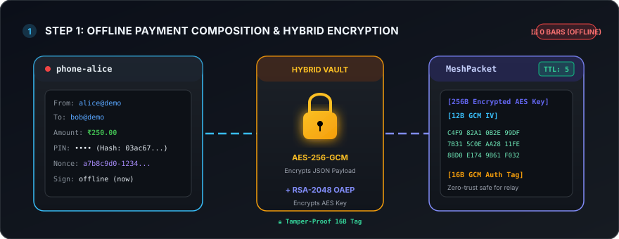
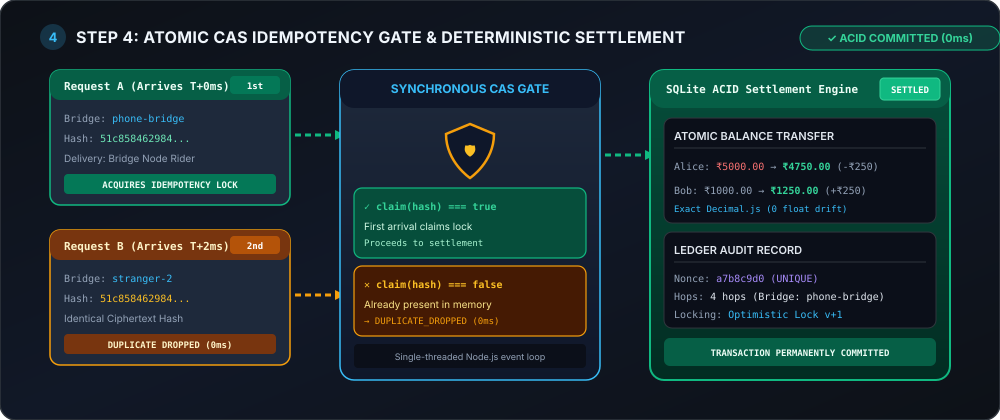

# zUPI: Offline UPI via Bluetooth Mesh & Opportunistic Settlement 📡

[](https://www.typescriptlang.org/)
[](https://nodejs.org/)
[](https://expressjs.com/)
[](https://www.sqlite.org/wal.html)
[](https://vitest.dev/)
[](LICENSE)

**zUPI** is a production-grade, zero-internet digital payment protocol built in **strict TypeScript / Node.js 20+ / Express**.

It enables offline UPI payments in scenarios where users have **zero cellular reception or Wi-Fi** (e.g. underground metro basements, remote hiking trails, disaster zones, or crowded stadiums). Encrypted payment tokens hop peer-to-peer across nearby devices via simulated **Bluetooth Low Energy (BLE)** gossip until an internet-connected device surfaces as a **Bridge Node**, opportunistically uploading the packet to the banking backend for deterministic, exactly-once ACID settlement.

---

## 🏗 System Architecture

```text
  [Phone Alice] (Offline Basement)
        │
        │ 1. AES-256-GCM + RSA-2048 Hybrid Encryption
        ▼
  [BLE Gossip Mesh] (TTL=5, seenHashes Filter)
        │
        ├─► [Stranger 1] ───► [Stranger 2] ───► [Stranger 3]
        │                                             │
        │                                             │ BLE Hops
        │                                             ▼
        │                                    [Phone Bridge] (Surfaces into 4G)
        │                                             │
        │                                             │ 2. HTTPS POST /api/bridge/ingest
        │                                             │    (X-Bridge-Node-Id: phone-bridge)
        │                                             ▼
        │                              ┌──────────────────────────────────────────────┐
        │                              │ zUPI Express Banking Gateway                 │
        │                              │                                              │
        │                              │ • Compute SHA-256(ciphertext)                │
        │                              │ • Tier 1: In-Memory Lock (0ms fast path)     │
        │                              │ • Tier 2: SQLite WAL `processed_packets`     │
        │                              │ • Decrypt Session Key (RSA-2048 Private)     │
        │                              │ • Decrypt Payload (AES-256-GCM + Auth Tag)   │
        │                              │ • Verify Signed Timestamp & 24h Freshness    │
        │                              │ • ACID Atomic Settlement (Decimal.js):       │
        │                              │     Alice: -₹250.00                          │
        │                              │     Bob:   +₹250.00                          │
        │                              │     Bridge: +₹0.50 Protocol Bounty 💰        │
        │                              └──────────────────────┬───────────────────────┘
        │                                                     │
        │                                                     │ 3. Settlement ACK Emitted
        │                                                     ▼
        └◄───────── ↺ REVERSE SETTLEMENT ACK (PURGES ALL DEVICE BUFFERS) ─────────────┘
```

---

## ⚡ Three Architectural Core Upgrades

### 1. Loop-Free BLE Gossip & Reverse ACK Mesh Purge
* **Seen-Packet Loop Blocker:** Each device maintains a local `seenHashes: Set<string>`. When a packet arrives, if its SHA-256 hash has already been observed, it is dropped immediately. This guarantees that devices in proximity never get stuck in infinite ping-pong relay loops.
* **Reverse Settlement ACK Kill-Switch:** Once the backend settles a transaction, it returns an ACK containing `{ packetHash, status: "SETTLED" }`. As bridge devices relay this ACK back into the BLE mesh, intermediate phones match the settled hash against their internal storage and immediately purge the buffered packet (`buffer.delete(packetHash)`). This frees device RAM across the network and permanently suppresses dead gossip traffic.

### 2. Bridge Node Micro-Bounty Incentive (₹0.50 Protocol Reward)
* **Decentralized Carrier Economics:** Why would strangers relay payment packets on behalf of others? zUPI introduces an automatic **₹0.50 Protocol Micro-Bounty** credited to the first bridge node that successfully surfaces with mobile data and delivers the transaction to the bank.
* **Sybil & Race Resistant:** If multiple bridge nodes surface simultaneously and submit identical ciphertexts, only the first arrival acquires the idempotency lock and earns the bounty. The concurrent duplicate upload receives HTTP 200 `DUPLICATE_DROPPED` with `bountyEarned: "₹0.00"`.
* **Auditable Ledger:** Bounty credits are recorded in the `bridge_rewards` table and can be inspected in real time via `GET /api/bridges/rewards`.

### 3. SQLite WAL Mode & Persistent CAS Idempotency Gate
* **Survives Server Reboots & Crashes:** Memory-only caches lose state when servers restart. zUPI couples an in-memory 0ms atomic compare-and-swap (CAS) gate with a persistent SQLite table (`processed_packets`) featuring `packet_hash TEXT PRIMARY KEY`.
* **High-Concurrency WAL Mode:** SQLite runs with Write-Ahead Logging (`PRAGMA journal_mode = WAL`, `PRAGMA synchronous = NORMAL`, and `busy_timeout = 5000ms`), enabling continuous non-blocking concurrent reads and resilient crash durability.

---

## 🎬 Real-Life Scenario: Step-by-Step Data Flow & Functioning

### 📌 Scenario Setup
> **Real-World Context:**
> Maan lijiye **Alice** ek underground food court mein hai jahan **0 bars of mobile network (zero internet)** hai. Use **Bob (`bob@demo`)** ko **₹250.00** pay karne hain.

---

### Step 1: Offline Payment Composition & Hybrid Encryption (Client-Side)

Kyunki internet nahi hai, Alice ka phone seedhe bank server tak request nahi bhej sakta. Isliye, uska phone local device par hi transaction ko securely encrypt karta hai taaki koi beech mein tamper na kar sake.

> 💡 **Hinglish Explanation:**
> Alice jaise hi UPI PIN dalti hai, app ek temporary (ephemeral) session key banata hai. Is session key se payment details ko encrypt kiya jata hai taaki koi beech ke raste mein data chura na sake. Phir is session key ko bank ke RSA public key se lock kar diya jata hai.



#### 🛠 Libraries & Functions Used:
* **Node.js `crypto` module (ya browser Web Crypto APIs):**
  * `crypto.randomBytes(32)`: 256-bit random AES session key generate karne ke liye.
  * `crypto.createCipheriv('aes-256-gcm', key, iv)`: **AES-256-GCM** authenticated symmetric encryption perform karne ke liye (16-byte GCM authentication tag ke sath).
  * `crypto.publicEncrypt({ key: bankPublicKey, padding: crypto.constants.RSA_PKCS1_OAEP_PADDING }, aesKey)`: **RSA-2048 OAEP (SHA-256)** encryption use karke AES key ko bank ke public key se securely wrap/lock karne ke liye.
* **Wire Format Assembly:**
  * `Buffer.concat([encryptedKey, iv, ciphertext, authTag])` — Encrypted binary envelope tayar hota hai aur isse initial `TTL = 5` assign kiya jata hai.

---

### Step 2: Peer-to-Peer Bluetooth Mesh Gossip (P2P Transit)

Alice ke phone ke paas internet nahi hai, toh uska phone is encrypted packet ko Bluetooth Low Energy (BLE) / Wi-Fi Direct waves ke through aas-paas ke strangers ke phones par broadcast (gossip) karta hai.

> 💡 **Hinglish Explanation:**
> Packet ek phone se doosre phone par hop karta hai (jaise `Stranger 1` ➔ `Stranger 2` ➔ `Stranger 3`). Yeh devices packet ke andar ki details nahi padh sakte kyunki data strictly encrypted hai. Loop banne se rokne ke liye har phone ek `seenHashes` filter rakhta hai.



#### 🛠 Libraries & Functions Used:
* **TypeScript native `Set<string>` (`seenHashes`):**
  * Har device local memory mein `seenHashes.has(packetHash)` check karti hai. Agar packet hash pehle se dekha gaya hai, toh turant drop kar diya jata hai taaki battery-draining infinite ping-pong loops avoid kiye ja sakein.
* **TTL (Time-To-Live) Counter:**
  * Packet header mein `TTL = 5` hota hai jo har hop par decrement hota jata hai (`5 → 4 → 3 → 2 → 1`). Jab `TTL = 0` ho jata hai, packet drop ho jata hai.
* **Reverse Settlement ACK Buffer Purge:**
  * Jab bank se settlement confirm hoti hai, ACK reverse travel karta hai aur `buffer.delete(packetHash)` call karke phone RAM storage ko permanently clean kar deta hai.

---

### Step 3: Opportunistic 4G Bridge Upload & Micro-Bounty Incentive

Ek delivery rider (`phone-bridge`) jo in packets ko carry kar raha tha, escalator se upar aata hai aur 4G/5G mobile network zone mein pahunch jata hai.

> 💡 **Hinglish Explanation:**
> Jaise hi bridge node ko internet milta hai, woh apne buffer mein rakhe saare encrypted packets ko bank ke server par POST request ke zariye bhej deta hai. Iska fayda uthane ke liye system bridge node ko ₹0.50 ka protocol micro-bounty deta hai taaki log offline data carry karne ke liye motivated rahein.



#### 🛠 Libraries & Functions Used:
* **Express.js (v4.19):**
  * **Endpoint:** `POST /api/bridge/ingest`
  * **Headers parsing:** `req.headers['x-bridge-node-id']` se identify kiya jata hai ki kis bridge node ne packet deliver kiya hai taaki use micro-bounty reward mil sake.
  * `req.headers['x-hop-count']`: Audit logs ke liye hop count track kiya jata hai.
* **Race Condition & Storm Protection:**
  * Agar do bridge nodes concurrent packets bhejte hain, pehle aane wale ko ₹0.50 milta hai; concurrent duplicate ko HTTP 200 `DUPLICATE_DROPPED` milta hai (`bountyEarned: "₹0.00"`).

---

### Step 4: Two-Tier CAS Idempotency & ACID Settlement (Bank Gateway)

Server par request aane ke baad banking backend ye ensure karta hai ki double-spending na ho aur transaction bilkul safe ho.

> 💡 **Hinglish Explanation:**
> Server sabse pehle check karta hai ki kya yeh packet pehle process ho chuka hai (idempotency check). Phir server apne RSA private key se decryption karta hai, aur `Decimal.js` ka use karke exact mathematical precision ke sath Alice ke account se paise kaat kar Bob ke account mein bhej deta hai aur bridge node ko reward credit karta hai.



#### 🛠 Libraries & Functions Used:
* **SQLite (with WAL Mode - Write-Ahead Logging):**
  * `PRAGMA journal_mode = WAL;` — High concurrency aur fast reads/writes ke liye.
  * `PRAGMA synchronous = NORMAL;` & `PRAGMA busy_timeout = 5000;`
  * `processed_packets` table jisme `packet_hash TEXT PRIMARY KEY` hota hai, taaki server reboot ya crash ke baad bhi same packet dobara process na ho sake.
* **`decimal.js` library:**
  * Floating-point rounding errors (jaise JavaScript ke standard math bugs `0.1 + 0.2 !== 0.3`) se bachne ke liye exact decimal calculations (`new Decimal(aliceBalance).minus(250)`) perform karne ke liye.
* **Node.js `crypto` decryption:**
  * `crypto.privateDecrypt({ key: serverPrivateKey, padding: crypto.constants.RSA_PKCS1_OAEP_PADDING }, encKey)`: Bank private key se AES session key ko unlock karne ke liye.
  * `crypto.createDecipheriv('aes-256-gcm', aesKey, iv).setAuthTag(authTag)`: Authenticated payload recovery aur tamper verification ke liye.
* **`bridge_rewards` Table:**
  * Winning bridge node ko `INSERT INTO bridge_rewards ...` ke zariye ₹0.50 add kiya jata hai, jo `GET /api/bridges/rewards` par queryable hota hai.

---

## 🚀 Quick Start

### Prerequisites
* **Node.js 20+**
* **npm 9+**

### 1. Installation
```bash
git clone https://github.com/Shivam-Singh-1/zUPI.git
cd zUPI
npm install
```

### 2. Run Test Suite
Verify cryptographic invariants, concurrent duplicate storms, and mesh ACK purges:
```bash
npm test
```

### 3. Run Development Server
```bash
npm run dev
```

### 4. Build & Run Production Bundle
```bash
npm run build
npm start
```

Visit **[http://localhost:8080](http://localhost:8080)** to access the **Interactive Live Control Dashboard**.

---

## 🧪 Security & Correctness Invariants (11/11 Vitest Tests)

| Test Suite | Scenario Verified | Outcome |
| :--- | :--- | :--- |
| `singlePacketDeliveredByThreeBridgesSettlesExactlyOnce` | 3 bridge nodes simultaneously upload the exact same packet with 0ms delay. | **Passed** — Exactly 1 settles (₹100.00 debited); 2 concurrent duplicates dropped. |
| `tamperedCiphertextIsRejected` | Single-bit alteration in ciphertext during mesh transit. | **Passed** — AES-GCM auth tag verification fails; transaction rejected as `INVALID`. |
| `encryptDecryptRoundTrip` | Roundtrip cryptographic serialization, hybrid encryption, and decryption. | **Passed** — Plaintext instruction recovered with bit-for-bit fidelity. |
| `sameNonceWithDifferentCiphertextCannotSettleTwice` | Malicious actor encrypts the same nonce under a fresh AES session key. | **Passed** — CAS gate passes, but ledger unique constraint stops the second debit. |
| `firstBridgeWinsBountyAndBroadcastsAckToClearMesh` | 3 bridge nodes race to upload; winning bridge receives ₹0.50; reverse ACK clears mesh. | **Passed** — Winner earns ₹0.50; mesh packet buffer count drops from 4 to 0. |
| `GET /` | Dashboard HTML static serving. | **Passed** — HTTP 200 with complete interactive interface. |
| `GET /api/server-key` | RSA-2048 SPKI public key retrieval. | **Passed** — Base64 DER public key returned for client-side encryption. |
| `GET /api/accounts` | Query seeded demo accounts. | **Passed** — Returns Alice (₹5,000), Bob (₹1,000), Charlie, and Merchant accounts. |
| `full demo lifecycle: send -> gossip -> flush` | End-to-end integration across all endpoints. | **Passed** — Packet created, gossiped across 5 hops, uploaded, and balances updated. |
| `direct POST /api/bridge/ingest` | Direct ingestion validation with bridge headers. | **Passed** — Settles cleanly, drops subsequent replay with 200 OK `DUPLICATE_DROPPED`. |
| `GET /api/bridges/rewards` | Protocol micro-bounty queries. | **Passed** — Accurately returns breakdown of bounties per bridge node. |

---

## 📡 REST API Reference

| Method | Endpoint | Description |
| :--- | :--- | :--- |
| `GET` | `/` | Serves the interactive web dashboard. |
| `GET` | `/api/server-key` | Retrieves the bank's active 2048-bit RSA SPKI public key. |
| `GET` | `/api/accounts` | Lists current balances for all seeded demo accounts. |
| `GET` | `/api/transactions` | Lists the 20 most recent settled or rejected transactions. |
| `GET` | `/api/bridges/rewards` | Returns total micro-bounties earned by relaying bridge nodes. |
| `POST` | `/api/demo/send` | Offline simulator: creates and encrypts a payment from Alice to Bob. |
| `GET` | `/api/mesh/state` | Returns the current topology, device buffers, and idempotency status. |
| `POST` | `/api/mesh/gossip` | Simulates 1 round of peer-to-peer BLE gossip propagation. |
| `POST` | `/api/mesh/flush` | Triggers all surfaced 4G bridge nodes to upload held packets. |
| `POST` | `/api/mesh/reset` | Resets mesh device buffers, account balances, and idempotency caches. |
| `POST` | `/api/bridge/ingest` | Primary bridge ingestion endpoint (`X-Bridge-Node-Id` authenticated). |

---

## 🔒 Cryptographic Specifications

* **Symmetric Encryption:** AES-256-GCM (Galois/Counter Mode) with 96-bit random IVs and 128-bit authentication tags.
* **Asymmetric Encryption:** RSA-2048 with Optimal Asymmetric Encryption Padding (OAEP) utilizing SHA-256.
* **Hash Digests:** SHA-256 for packet idempotency tagging and PIN hashing.
* **Numeric Precision:** `Decimal.js` used exclusively for balance computations to eliminate floating-point rounding errors.
* **Storage Engine:** SQLite 3 in Write-Ahead Logging (`WAL`) mode with prepared statements to prevent SQL injection.

---

## 📄 License
This project is licensed under the [MIT License](LICENSE).
